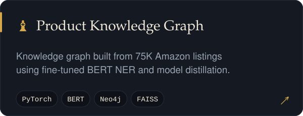
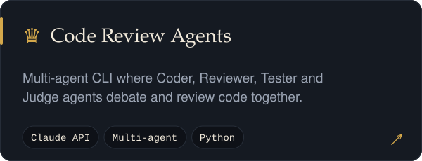
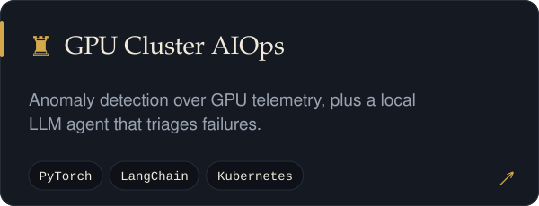
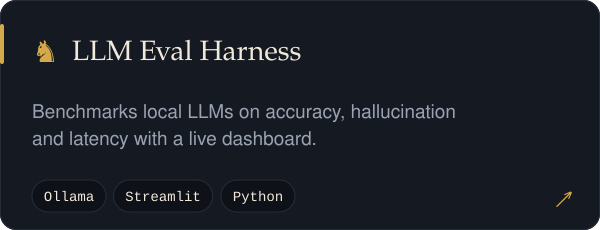
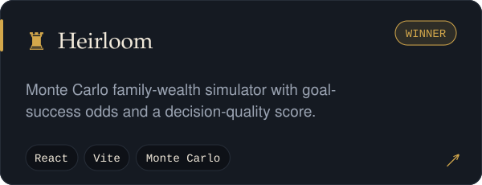
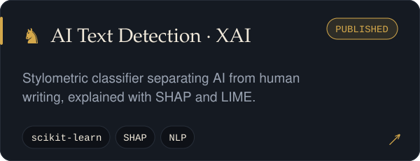
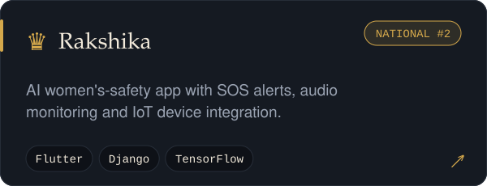
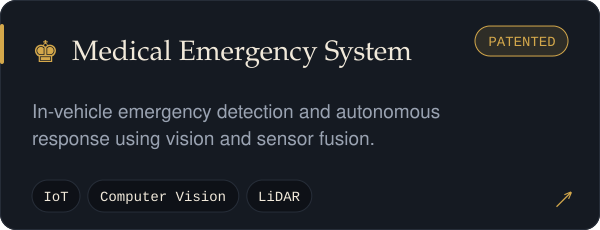
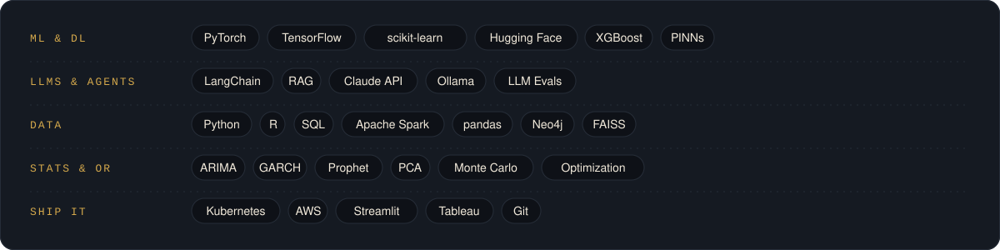

  

  
  
  
  
  

  

I build ML systems that think a few moves ahead, from **LLMs and agentic AI** to **physics-informed neural networks** and **time-series forecasting**. I hold an **MS in Data Science from the University of Minnesota** (Operations Research concentration) and a B.Tech in Computer Engineering from Mumbai.

- 🏭 **Daikin Applied:** Data Scientist (Capstone), applied ML on HVAC engineering data
- 🔬 **University of Minnesota:** Research Assistant  ·  **IIT Patna:** Research Intern
- 📈 **Moneyline Futures:** Machine Learning Developer

 

  
  
  
  
  
  
  
  

  <b>More moves:</b>
  <a href="https://github.com/adityashah841/Aura">Aura</a> ·
  <a href="https://github.com/adityashah841/Lawbuddy">LawBuddy</a> ·
  <a href="https://github.com/adityashah841/Analytics-Projects">Big Tech Stock Analytics</a> ·
  <a href="https://github.com/adityashah841/Data-Mining-Projects">Spark Data Mining</a> ·
  <a href="https://github.com/adityashah841/Visualizations">Tableau Dashboards</a>

 

  

  

